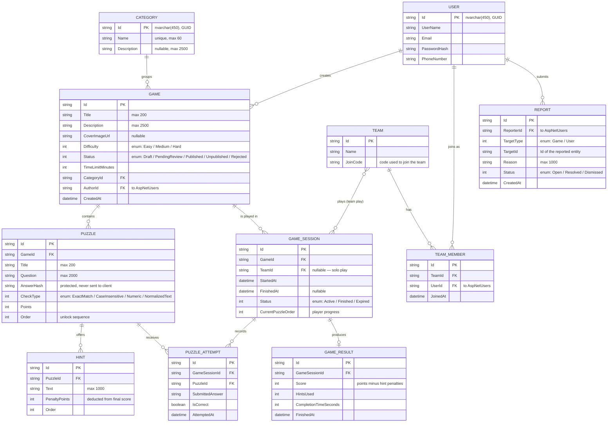

# Database Schema — Escape Room Platform

> Rendered with Obsidian's built-in Mermaid support (switch to **Reading view** / open the diagram).
>
> Status: **User** and **Category** are implemented in the database. The remaining entities are the target schema and will be added model-by-model.

## Entity Relationship Diagram

## Implementation status

| Entity        | Table                           | Status                        |
| ------------- | ------------------------------- | ----------------------------- |
| User          | AspNetUsers (+ Identity tables) | Implemented — `InitialCreate` |
| Category      | Categories                      | Implemented — `AddedCategory` |
| Game          | Games                           | Planned                       |
| Puzzle        | Puzzles                         | Planned                       |
| Hint          | Hints                           | Planned                       |
| GameSession   | GameSessions                    | Planned                       |
| Team          | Teams                           | Planned                       |
| TeamMember    | TeamMembers                     | Planned                       |
| PuzzleAttempt | PuzzleAttempts                  | Planned                       |
| GameResult    | GameResults                     | Planned                       |
| Report        | Reports                         | Planned                       |

## Design notes

- All primary keys are **string GUIDs** (`Guid.NewGuid().ToString()` in the constructor), matching ASP.NET Core Identity's string user IDs.
- **AnswerHash** stores the protected answer representation server-side; it is never sent to the client before the puzzle is solved (anti-cheating requirement).
- **Hint.PenaltyPoints** is deducted from the final score when a hint is used (scoring rule).
- **Puzzle.Order** drives the sequential unlock: a correct answer unlocks the puzzle with the next order value.
- Deleting a **Category** must not cascade to its **Games** (Restrict); deleting a **Game** cascades to its **Puzzles** and **Hints**.
